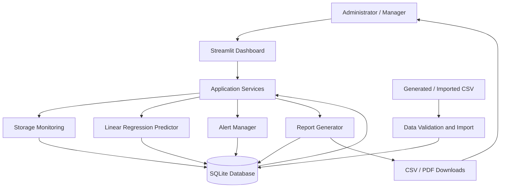

# Application Architecture
## Intelligent Storage Capacity Monitoring and Prediction System

**Architecture decision:** Streamlit + Python. React is not part of the currently approved stack. The earlier project selection explicitly chose Streamlit; do not introduce React unless the project owner approves an architecture change.

## 1. Architecture overview

The application follows a layered, modular architecture:

1. **Presentation layer:** Streamlit pages, filters, metric cards, charts, and download controls.
2. **Application/service layer:** Coordinates monitoring, forecasting, alerts, and report generation.
3. **Domain/logic layer:** Capacity calculations, validation, threshold rules, and prediction logic.
4. **Data access layer:** Reads/writes CSV input and SQLite records.
5. **Storage layer:** CSV source data and SQLite database.



## 2. Main application flow

1. Start Streamlit using `streamlit run app.py`.
2. Load the configured dataset or retrieve stored observations from SQLite.
3. Validate required columns, data types, date values, capacity values, and utilization ranges.
4. Calculate total, used, available, and percentage utilization.
5. Display summary metrics and historical charts.
6. Train a separate Linear Regression model for the selected server.
7. Generate forecasts and, when defensible, estimate a threshold-crossing date.
8. Evaluate current utilization against configured alert thresholds.
9. Display alerts and allow CSV/PDF downloads.
10. Persist imported records and generated alert information in SQLite.

## 3. Technology stack

| Layer | Technology | Responsibility |
|---|---|---|
| UI | Streamlit | Web dashboard |
| Language | Python | Application logic |
| Data manipulation | Pandas, NumPy | Data loading and calculations |
| Prediction | Scikit-learn | Linear Regression |
| Charts | Plotly | Interactive graphs |
| Database | SQLite | Persistent local storage |
| PDF | ReportLab | PDF report creation |
| CSV | Pandas | CSV report creation |
| Testing | pytest | Unit and integration tests |

## 4. Proposed folder and file structure

```text
Intelligent_Storage_Capacity_Monitoring_System/
│
├── app.py                         # [Phase 5] Streamlit entry point and page routing
├── requirements.txt               # [Phase 0] Python dependencies and versions
├── README.md                      # [Phase 0] Setup, run, test, and usage instructions
├── PRD.md                         # [Phase 0] Product requirements and acceptance criteria
├── architecture.md                # [Phase 0] Architecture, flow, stack, and structure
├── rules.md                       # [Phase 0] Coding standards, boundaries, and safety rules
├── phases.md                      # [Phase 0] Implementation roadmap and phase gates
├── design.md                      # [Phase 0] Visual design system
├── memory.md                      # [All phases] Progress log; initially contains only instructions
├── AI_AGENT_PROMPT.md             # [Phase 0] Reusable instructions for an AI coding agent
│
├── data/
│   ├── README.md                  # [Phase 1] Dataset provenance, schema, and regeneration notes
│   └── storage_data.csv           # [Phase 1] Generated/imported storage observations (generated)
│
├── database/
│   ├── README.md                  # [Phase 2] Database setup and schema notes
│   └── storage.db                 # [Phase 2] SQLite database (created at runtime; do not commit real data)
│
├── modules/
│   ├── __init__.py                # [Phase 1] Marks modules as a Python package
│   ├── data_generator.py          # [Phase 1] Creates reproducible synthetic storage records
│   ├── data_loader.py             # [Phase 1] Loads and validates CSV data
│   ├── storage_monitor.py          # [Phase 2] Capacity, free-space, and utilization calculations
│   ├── database_manager.py         # [Phase 2] SQLite schema and CRUD operations
│   ├── alert_manager.py            # [Phase 3] Threshold evaluation and alert generation
│   └── report_generator.py         # [Phase 4] CSV and PDF report generation
│
├── models/
│   ├── __init__.py                # [Phase 3] Marks models as a Python package
│   └── prediction_model.py        # [Phase 3] Per-server Linear Regression and forecast logic
│
├── pages/
│   ├── 1_Storage_Monitoring.py     # [Phase 5] Server-wise capacity and history view
│   ├── 2_Capacity_Prediction.py    # [Phase 5] Forecasts and estimated threshold dates
│   ├── 3_Alerts.py                 # [Phase 5] Alert list and threshold configuration
│   └── 4_Reports.py                # [Phase 5] Report filters and download controls
│
├── assets/
│   └── style.css                  # [Phase 5] Optional small set of approved UI style overrides
│
├── tests/
│   ├── test_data_loader.py         # [Phase 6] CSV validation tests
│   ├── test_storage_monitor.py     # [Phase 6] Capacity calculation tests
│   ├── test_prediction_model.py    # [Phase 6] Forecast and edge-case tests
│   └── test_alert_manager.py       # [Phase 6] Threshold boundary tests
│
└── .gitignore                     # [Phase 0] Excludes venv, database, caches, and generated artifacts
```

**Generated files:** `data/storage_data.csv` is created by the generator. `database/storage.db` is created by the database initialization code. Do not create fake/empty runtime database files merely to make the tree look complete.

## 5. Data model

### `servers`
- `server_id` (primary key)
- `total_capacity_gb`
- `created_at`

### `storage_records`
- `id` (primary key)
- `server_id` (foreign key)
- `record_date`
- `used_storage_gb`
- `available_storage_gb`
- `usage_percentage`

### `alerts`
- `id` (primary key)
- `server_id` (foreign key)
- `alert_date`
- `usage_percentage`
- `severity`
- `message`
- `status`

## 6. Module boundaries

- UI pages call service/business modules; they should not duplicate calculations.
- Prediction code must not directly manipulate Streamlit widgets.
- Database code owns SQL statements and connections.
- Alert logic owns threshold classification.
- Report logic accepts prepared data and returns downloadable bytes or file-like objects.
- Dataset generation must be deterministic when using the configured seed.
- Do not couple the app to a real server or cloud API in the initial version.

## 7. Architecture constraints

- Use Streamlit, not React, for the approved initial implementation.
- Keep the initial app runnable locally on a student's machine.
- Use synthetic data until the owner explicitly approves a real data source.
- Keep all units explicit (GB, days, percentage).
- Forecasts must be marked as estimates and show their forecast horizon.
